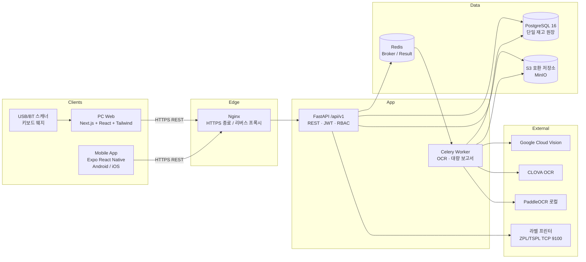

# 시스템 아키텍처 — Food Manufacturing ERP & MES

## 1. 전체 구성



- **단일 진실 원천(Single Source of Truth)**: Web·Mobile은 동일한 REST API만 호출한다. 클라이언트에 독립 재고 저장소를 두지 않는다(모바일 오프라인 큐는 “전송 대기 요청”만 보관하며 재고를 계산하지 않는다).
- **재고 무결성**: 모든 수량 변경은 `inventory_service`의 단일 함수(`post_movement`)를 통해 `inventory_transactions`(불변 원장) + `inventory_balances`(잔량) 를 **같은 DB 트랜잭션**에서 갱신한다. 잔량 행은 `SELECT … FOR UPDATE`로 잠그고, DB `CHECK (quantity >= 0)`로 음수를 이중 차단한다.
- **추적 무결성**: 모든 물리적 투입/산출은 `trace_events` + `trace_event_inputs/outputs`로 기록된다. 조회는 PostgreSQL Recursive CTE.

## 2. 기술 스택(검증·고정 버전)

| 계층 | 기술 | 고정 버전 |
|---|---|---|
| Backend | Python | 3.12 |
| | FastAPI / Starlette | 0.165.0 / 1.10.0 |
| | SQLAlchemy / Alembic | 2.1.9 / 1.20.1 |
| | Pydantic / pydantic-settings | 2.14.4 / 2.16.3 |
| | psycopg (v3, binary) | 3.3.9 |
| | PyJWT / bcrypt | 2.15.1 / 5.0.0 |
| | openpyxl / ReportLab / qrcode | 3.1.5 / 5.1.1 / 8.2 |
| | Celery / redis-py | 5.7.0 / 8.2.0 |
| DB | PostgreSQL | 16 |
| Cache/Queue | Redis | 7 |
| Storage | MinIO (S3 API) / boto3 | RELEASE.2025+ / 1.44 |
| Web | Next.js / React / TypeScript / Tailwind | `apps/web/package.json` 참조 |
| Mobile | Expo SDK / React Native | `apps/mobile/package.json` 참조 |

정확한 버전은 `backend/requirements.txt`, 각 `package.json`, `package-lock.json`에 고정한다.

## 3. Backend 레이어 구조

```
backend/app/
├── main.py                 # FastAPI 앱, 미들웨어, 라우터 등록
├── core/                   # config, db, security(JWT/bcrypt), errors, responses,
│                           # request_id, deps(인증·권한·공장범위), idempotency, audit, numbering
├── models/                 # SQLAlchemy ORM (조직/기준/입고/재고/BOM/생산/완제품/추적/공통)
├── schemas/                # Pydantic 요청/응답 스키마
├── repositories/           # 공통 조회/페이지네이션 헬퍼
├── services/
│   ├── inventory/          # 원장/잔량/예약/이동/조정/실사/FEFO
│   ├── ocr/                # Provider Adapter(Google/CLOVA/Paddle/PDF텍스트/Mock), 파서, 정규화
│   ├── qr/                 # QR payload 생성/해석, 라벨 PDF
│   ├── printing/           # PDF/ZPL/TSPL 어댑터, 네트워크 프린터 전송
│   ├── production/         # BOM, 제조지시, 소요량, 배치, 공정, 완제품, 수율
│   ├── weighing/           # QR 계량 검증, 차감, WB 생성, 역거래
│   ├── traceability/       # trace node/event, 재귀 탐색, 회수
│   └── reports/            # 보고서 정의, XLSX/PDF 생성
├── api/v1/                 # 라우터(모듈별)
└── workers/                # Celery 앱/태스크
```

### 요청 처리 파이프라인

1. `RequestIdMiddleware` — `X-Request-ID` 수신 또는 UUID 생성, 응답 헤더/본문에 포함.
2. 인증 의존성 — `Authorization: Bearer <access JWT>` 검증, 사용자 활성/잠금 확인.
3. 공장 범위 — `X-Facility-Id` 헤더(없으면 사용자 기본 공장). `user_facilities`에 없으면 403 `FACILITY_FORBIDDEN`(SUPER_ADMIN 제외).
4. 권한 — 라우트별 `require_permission("receipt:post")`. 역할→권한은 DB(`role_permissions`)로 관리.
5. Idempotency — 변경 API는 `Idempotency-Key` 헤더 지원. 같은 트랜잭션 안에서 키 선점(INSERT … ON CONFLICT) → 처리 → 응답 저장. 동일 키+다른 본문 → 409 `IDEMPOTENCY_CONFLICT`.
6. 서비스 — 상태 전이 검사, 비즈니스 규칙, 원장 기록, 추적 이벤트, 감사로그.
7. 응답 — `{"success":true,"data":…,"message":…,"request_id":…}` / 오류 `{"success":false,"error_code":…}`.

## 4. 동시성·정합성 전략

| 위험 | 대응 |
|---|---|
| 동시 차감(필수테스트 011) | 잔량 행 `FOR UPDATE` 잠금(정렬된 순서로 잠가 교착 방지) + `CHECK(quantity>=0)` |
| 중복 요청(010, 020) | `idempotency_keys` UNIQUE(org, key) + 원장 `idempotency_key` UNIQUE |
| 번호 중복 | `number_sequences` 행 `INSERT … ON CONFLICT DO UPDATE … RETURNING` 원자 증가 + 번호 컬럼 UNIQUE |
| 이력 변조 | 원장/추적/감사 테이블은 UPDATE/DELETE 하지 않음(애플리케이션 정책 + DB 트리거로 차단) |
| 소수 오차 | 수량 `NUMERIC(20,6)`, Python `Decimal` |
| 다공장 격리 | 모든 조회에 `organization_id`, 해당 시 `facility_id` 조건 강제 |

## 5. 비동기 작업

- OCR 처리와 대량 보고서는 Celery 태스크로 실행(`CELERY_ENABLED=true`). 재시도(지수 백오프 3회) 후 실패 상태 기록, `/ocr/jobs/{id}/retry`로 재처리.
- 개발 환경에서 Redis가 없으면 `CELERY_ENABLED=false`로 FastAPI BackgroundTasks(인프로세스)에서 동일 함수 실행.

## 6. OCR Provider Adapter

```
OCRProvider (interface)  extract(file_bytes, mime) -> OCRRawResult(text, blocks[{text, confidence, bbox}])
 ├── GoogleVisionProvider   (REST, GOOGLE_VISION_API_KEY)          ※ 외부 API 키 필요
 ├── ClovaOCRProvider       (REST, CLOVA_OCR_URL / SECRET)         ※ 외부 API 키 필요
 ├── PaddleOCRProvider      (로컬 paddleocr 패키지)                 ※ 별도 설치 필요
 ├── PdfTextProvider        (텍스트 레이어 PDF, pypdf)              — 키 불필요, 실제 추출
 └── MockOCRProvider        (개발/테스트 전용, APP_ENV=production 시 기동 거부)
```

처리 단계: 원본 저장 → 전처리(EXIF 회전, 그레이스케일, 크기 정규화) → OCR → 구조화(문서 유형별 규칙 파서) → 필드 매핑 → 마스터 매칭(공급업체/원료 유사도) → 날짜/단위 정규화 → 신뢰도 평가(필드별, 기본 임계값 0.90, 설정 가능) → 사용자 검토 → 확정 저장. 없는 정보는 생성하지 않고 `null` + `missing` 표시.

## 7. QR / 라벨 / 인쇄

- QR payload에는 불변 식별자만: `{"version":1,"type":"RAW_MATERIAL_PACKAGE","id":"<entity UUID>","lot":"RM-20261125-000001"}`.
- 해석(`POST /qr/resolve`)은 서버에서 최신 상태(잔량, 품질, 기한, 위치)를 조회.
- 라벨: ReportLab PDF(50×30/60×40/80×50/100×70mm/사용자 지정), ZPL·TSPL 텍스트 생성, `printer_settings`의 네트워크 프린터(TCP 9100)로 전송. 인쇄 실패는 입고/LOT 트랜잭션과 분리되어 있어 롤백되지 않으며 PDF 대체 경로를 반환.

## 8. 보안

- bcrypt 비밀번호 해시, 로그인 5회 실패 시 15분 잠금(설정 가능).
- Access JWT 15분, Refresh 14일(서버 저장·해시·회전·폐기).
- RBAC + 공장 범위, 감사로그(전후 값, 사유, IP, User-Agent, request_id; 비밀번호/토큰 제외, 수정·삭제 API 없음 + DB 트리거로 UPDATE/DELETE 차단).
- 파일 업로드: 확장자 + 매직바이트 검사, 크기 제한, 비공개 저장소, 인증된 다운로드 API만 허용.
- XLSX 수식 주입 방지(`=,+,-,@` 시작 문자열 이스케이프), LOT 문자열 텍스트 서식.
- 비밀은 환경변수로만 주입(`.env.example` 참조), OCR 키는 서버에서만 사용.

## 9. 배포

- `docker-compose.yml`: postgres, redis, minio, backend(API), worker(Celery), web(Next.js), nginx(HTTPS).
- 개발(Windows, Docker 미설치 환경): `infrastructure/scripts/dev-db.py`가 pip 패키지 `pgserver`에 포함된 PostgreSQL 16 바이너리로 로컬 DB 기동. 자세한 내용은 `docs/deployment.md`.
- 백업: `infrastructure/backup/backup.sh`(pg_dump + 첨부 동기화, 암호화, 보관 주기), 복구 절차 문서화. 초기 RPO 24h / RTO 4h.

## 10. 확장 포인트

- 저울 Adapter(USB/BT/RS232/TCP) — 계량 API는 `gross/tare/net/stable/scale_id`를 수용. 실제 장비 드라이버는 장비 검증 후 추가(※장비 필요).
- 센서/PLC 온도 수집 — `process_parameter_records`에 source=SENSOR로 저장.
- 외부 ERP/회계 — 원장/출고 이벤트 기반 연동 예정(범위 외).
