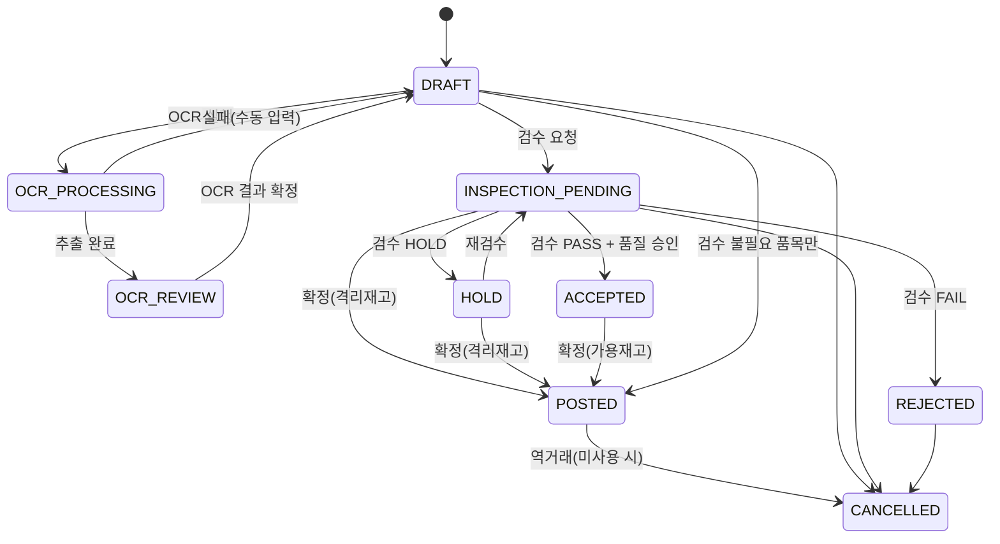
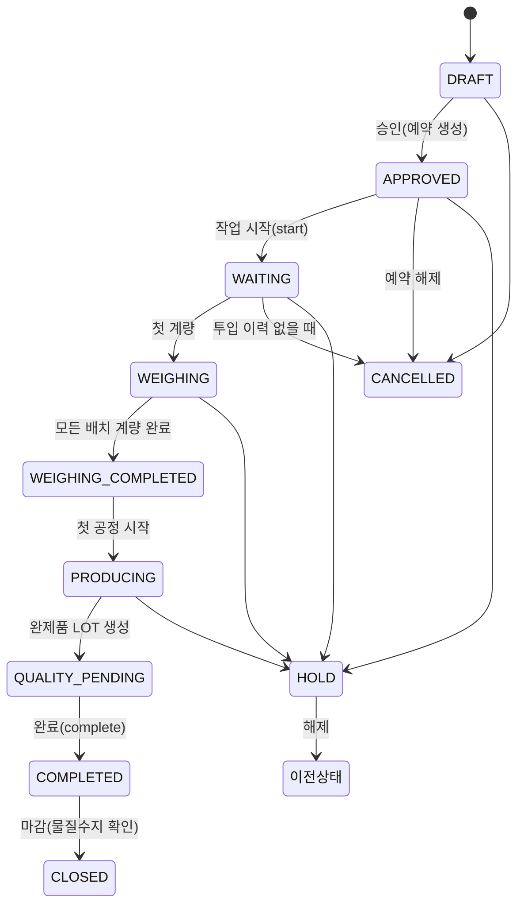

# 업무 규칙 (상태 전이 · 승인 · 재고 · 품질 · 추적)

모든 규칙은 서버(API)에서 강제한다. 클라이언트 검증은 UX 보조일 뿐이다.

## 1. 공통

| 규칙 | 내용 |
|---|---|
| 시각 | 서버 시각(UTC) 저장, Asia/Seoul 표시. 입고일시·계량시각 등은 클라이언트 값을 신뢰하지 않음 |
| 번호 | `PREFIX-YYYYMMDD-NNNNNN` 서버 원자 발급 (서울 기준 일자) |
| 삭제 | 거래 데이터 물리 삭제 금지(DB 트리거). 마스터는 비활성화 |
| 정정 | 승인된 기록 변경은 사유 + 관리자 승인. 재고는 역거래/조정으로만 |
| 감사 | 변경 API는 전후 값, 사유, 사용자, IP, User-Agent, request_id 기록 |
| 멱등 | 변경 API `Idempotency-Key` — 동일 키 재요청은 최초 응답 재생, 다른 본문이면 409 |

## 2. 원료 마스터

- 대분류 `MAIN_MATERIAL`(RM) / `SUB_MATERIAL`(PM) / `OTHER_MATERIAL`(OM). 원료코드 `RM-000001` 형식 자동 발급(직접 지정 가능, 조직 내 유일).
- 식품유형·식품첨가물 여부·배합 투입 여부(`production_usable`)는 별도 필드.
- 마스터 등록은 재고를 만들지 않는다.
- `OTHER_MATERIAL`은 기본 `production_usable=false`, `expiry_tracking_required=false`. BOM FORMULA 항목에 등록 불가.

## 3. 입고 상태 전이

- **확정(post)** 시점에만 LOT·포장·QR·재고·수불·추적 노드가 생성된다 (단일 트랜잭션).
- LOT 품질상태: 입고 `ACCEPTED`(검수 PASS + 승인) → `PASSED`, 그 외 → `PENDING`/`HOLD` (격리재고: 생산 투입·예약·출고 불가).
- 확정 후에도 검수/승인 가능: 승인 시 LOT `PASSED` 전환, FAIL 시 `REJECTED`(가용 전환 금지 → 반품/폐기만).
- `coa_required` 원료는 COA 문서가 연결되어야 품질 승인 가능.
- `expiry_tracking_required` 원료는 소비/유통기한 필수, 기한 유형 필수. 청소도구 등은 `NOT_APPLICABLE` 허용.
- 소비기한이 이미 지난 원료는 확정 불가.
- 입고 정정(reverse): 해당 LOT의 모든 포장이 미사용(잔량 = 최초 수량)일 때만 REVERSAL 거래로 취소.
- 라벨 출력 실패는 입고를 롤백하지 않는다. 재출력은 동일 QR, 사유·횟수·작업자·시각 기록.

## 4. LOT / 포장 / QR

- 100kg(20kg×5) → LOT 1개 + 포장 5개(각 QR) + 잔량 행 5개. LOT 잔량 = 포장 잔량 합.
- 포장 수량 미지정 시 균등 분할(나머지는 마지막 포장).
- QR payload: `{"version":1,"type":…,"id":<UUID>,"lot":…}` — 불변 식별자만. 상세는 서버 조회.
- 포장 상태: AVAILABLE → IN_USE(일부 사용) → EMPTY(잔량 0). DAMAGED/CONTAMINATED는 사용 불가.

## 5. 재고 / 수불

- 현재고 = Σ IN − Σ OUT (원장 기준). `inventory_balances`는 원장과 같은 트랜잭션으로만 갱신.
- 가용재고 = 합격(PASSED/RELEASED) ∧ 기한 내 ∧ 격리창고 아님 ∧ (현재고 − 예약).
- 추천: 기한관리 품목 FEFO(기한 빠른 순), 그 외 FIFO(LOT 번호 순).
- 차단: 기한 경과, 부적합, 보류, 검수대기, 재고 부족, 음수.
- 동시성: 잔량 행 `FOR UPDATE`, 다중 행은 id 정렬 순서로 잠금. 10kg에 7kg 동시 2건 → 1건 성공, 3kg.
- 조정: 요청(PENDING) → 관리자 승인 시 ADJUSTMENT_IN/OUT 거래. 실사 차이는 조정 요청으로만 반영.
- 이동: TRANSFER_OUT + TRANSFER_IN 동일 그룹.
- 폐기/반품/샘플/일반사용: 승인 요청 후 DISPOSAL/SUPPLIER_RETURN/SAMPLE_USE/GENERAL_USE.
- 단위 환산: 동일 차원(MASS/VOLUME/COUNT)은 `units.factor_to_base`, 중량↔부피는 품목별 검증된 밀도(`density_kg_per_l`) 필요. 없으면 `UNIT_CONVERSION_REQUIRED`.
- 알림: 소비기한 90/60/30/7일 전·경과, 안전재고 미달, 검수/COA 미완료, 장기 미사용(설정값).

## 6. BOM

- 상태: DRAFT → PENDING_APPROVAL → APPROVED → OBSOLETE (REJECTED).
- FORMULA 비율 합계 = 100% (±0.0001) 이어야 승인 가능. PACKAGING/PROCESS_AUXILIARY 는 100% 산정 제외.
- 수량 기준: RATIO(계획배합량 × 비율/100), FIXED(표준사용량 × 계획배합량/기준배합량), PER_UNIT(완제품 1단위당 × 목표 완제품 수량).
- 승인 전 사용 금지. 새 버전 승인 시 이전 APPROVED 버전은 OBSOLETE(이미 발행된 지시는 스냅샷 유지).
- 승인된 버전은 수정 불가 → 복사하여 새 버전 작성.

## 7. 제조지시 상태 전이

- 생성 시 승인 BOM 및 공정(라우팅) 버전 **스냅샷** 저장. 이후 BOM 개정과 무관.
- 필요량 자동 계산, 가용재고 비교, 부족 표시, FEFO 추천. 승인 시 가용분 예약(부족해도 승인 가능하되 부족 경고 반환 / `require_full_stock=true`면 차단).
- 배치: `batch_count` 개의 BATCH 번호 생성, 배치량 = 계획배합량 / 배치수.
- 마감: 물질수지 차이 = 총투입 − 정상산출 − 불량 − 폐기 − 확인손실 − 잔여공정재고 (+수분 변화 별도). 허용차 초과 시 관리자 확인(사유) 필요. 남은 예약 해제.

## 8. QR 계량

검증 순서(하나라도 실패 시 차단, 재고 변경 없음):
1. QR 형식/존재 (`INVALID_QR`)
2. 지시 상태 WAITING/WEIGHING (`ORDER_NOT_WEIGHABLE`)
3. 원료가 지시 품목(또는 승인된 대체 원료) (`MATERIAL_NOT_IN_ORDER`, `SUBSTITUTE_NOT_ALLOWED`)
4. LOT 품질 PASSED (`QUALITY_NOT_RELEASED`), 포장 사용 가능 (`PACKAGE_NOT_USABLE`)
5. 기한 경과 (`EXPIRED_MATERIAL`)
6. 단위 일치 (`UNIT_MISMATCH`)
7. 잔량 충분 (`INSUFFICIENT_STOCK`)
8. 허용오차: 개별(목표 대비 ±tolerance%) 및 그룹 누적. 초과 시 `TOLERANCE_EXCEEDED` — 승인 권한자(`weighing:reverse_approve`)의 `override_approved_by` 지정 시에만 허용.

- 확정 시 PRODUCTION_ISSUE 거래, 포장 잔량 갱신, 계량 기록(작업자/시각/저울), 추적 WEIGHING 이벤트(포장 → WB).
- 한 원료를 여러 LOT으로 분할 계량 가능(목표 누적).
- 중복 스캔: 조회는 허용, 동일 Idempotency-Key 재확정은 1회만 반영.
- WB 완료: 모든 그룹 품목이 허용오차 내 충족 시 `READY`, WB LOT/QR 생성, WIP_RECEIPT.
- 계량 정정(reverse): 원본 유지, REVERSAL 거래 + 추적 REVERSAL 이벤트. 승인 필요(승인 요청 또는 승인권자 직접). WB가 이미 공정에 투입되었으면 차단(`DOWNSTREAM_EXISTS`).
- 반납(return): 오염/혼합 원료 정상 반납 금지(`contaminated=true` → 폐기 처리).

## 9. 공정

- 상태: WAITING → IN_PROGRESS ⇄ PAUSED → COMPLETED / HOLD / FAILED / CANCELLED.
- 시작 조건: 이전 필수 공정 완료(`PREVIOUS_STEP_INCOMPLETE`), 지시 상태 진행 가능.
- 투입: WB/WIP QR, 같은 배치만(다른 배치는 `merge_approved_by` 필요), 품질 보류/부적합 차단, 소진/초과 사용 차단.
- 조건 기록: 사양 범위 밖이면 `out_of_range` 경고, CCP 공정의 범위 이탈은 공정 품질 HOLD.
- 완료: 필수 조건 누락 차단, 종료 > 시작, 산출 + 불량 + 폐기 + 손실 = 투입 + 수분변화(허용차 내). 공정수율 = 정상산출/투입 × 100.
- 출력: WIP LOT(복수 = 분할) 또는 마지막 공정의 FG LOT. 각 출력은 새 QR(입력 QR과 다름) + 부모-자식 추적.
- 재작업: `is_rework=true`, 입력 LOT 상태와 기존 이력 유지, REWORK 이벤트.

## 10. 포장재

- 포장 공정에서 포장재 포장 QR 스캔 → 사용/불량/폐기 수량 → PRODUCTION_ISSUE (실소모 = 사용+불량+폐기).
- 반납 수량은 차감하지 않음(남은 잔량 유지). FG LOT 생성 시 포장재 LOT → FG 추적 연결(PACKAGING 이벤트 입력).

## 11. 완제품

- FG LOT 품질 상태: QUALITY_PENDING → RELEASED / HOLD / REJECTED.
- 실물 재고는 FG_RECEIPT로 즉시 반영(조회 가능), **RELEASED 전 출고/예약 불가**.
- 소비기한 = 제품별 기산일(제조일) + `shelf_life_days` − 1 (식품 표시 관행: 제조일 포함). 원료 기한 복사 금지. 품질 승인 시 확인.
- 생산수율 = 정상 순중량(정상수량 × 내용량, kg) / 실제 총 식품원료 투입량(FORMULA 계량 실적, kg) × 100.
- 계획 달성률, 불량률, 공정수율 — 분모 0 또는 차원 불일치 시 `null` + `needs_review`.

## 12. 출고 / 반품

- 출고 확정 검증: FG RELEASED, 기한 내, 격리창고 아님, 잔량 충분. 위반 시 차단(`QUALITY_NOT_RELEASED`, `EXPIRED_PRODUCT`, `INSUFFICIENT_STOCK`).
- 확정 시 FG_SHIPMENT 거래, SHIPMENT 추적 이벤트(FG → 출고 → 거래처), 출고명세서 PDF.
- 출고 정정(reverse): 확정 출고 전체 REVERSAL.
- 반품: 원출고 품목 연결, 반품 가능 수량 ≤ 출고 − 기반품. 격리창고로 FG_RETURN → 품질 판단 후 재입고(TRANSFER) 또는 폐기(DISPOSAL).

## 13. 추적 / 회수

- 그래프 노드: 원료 LOT, 원료 포장, WB, WIP, FG LOT, FG 포장, 출고, 거래처. 이벤트 입력/출력 수량 기록.
- 정방향: 입고 LOT → 포장 → WB → WIP → FG → 출고 → 거래처. 역방향은 그 반대.
- 이벤트는 추가만. 취소는 REVERSAL 이벤트(탐색 시 제외), 재작업은 REWORK 이벤트.
- 순환 연결 금지(이벤트 생성 시 출력 노드가 입력의 조상인지 검사).
- 개별 FG 의 원료량: 배치 실측(계량 기록)과 비례 추정(FG 수량 비율)을 구분 표기.
- 회수: 사건 등록 → 문제 LOT 선택 → 영향 WIP/FG/재고/출고/거래처 자동 산출 → 재고 보류(품질 HOLD, 이전 상태 기록) → 회수 수량 기록 → 진행률 → 종료 시 보류 해제는 품질관리 권한으로 별도 승인.

## 14. 권한 매트릭스(요약)

| 기능 | SUPER_ADMIN | ADMIN | QM | WH | PM | WORKER | SHIP | VIEWER |
|---|---|---|---|---|---|---|---|---|
| 기준정보 등록 | ✔ | ✔ | | | | | 거래처 | |
| 입고 등록/확정 | ✔ | | | ✔ | | | | |
| 입고 검수/승인 | ✔ | | ✔ | | | | | |
| 재고 조정 승인 | ✔ | ✔ | | | | | | |
| BOM 작성 / 승인 | ✔ | ✔/✔ | /✔ | | ✔/ | | | |
| 제조지시 작성/승인 | ✔ | ✔ | | | ✔ | | | |
| 계량/공정 실행 | ✔ | | | | ✔ | ✔ | | |
| 완제품 출고승인(RELEASE) | ✔ | | ✔ | | | | | |
| 출고 확정 | ✔ | | | | | | ✔ | |
| 회수/보류 | ✔ | | ✔ | | | | | |
| 조회/출력 | ✔ | ✔ | ✔ | ✔ | ✔ | 일부 | ✔ | ✔ |

정확한 권한 코드는 `backend/app/core/permissions.py`.
