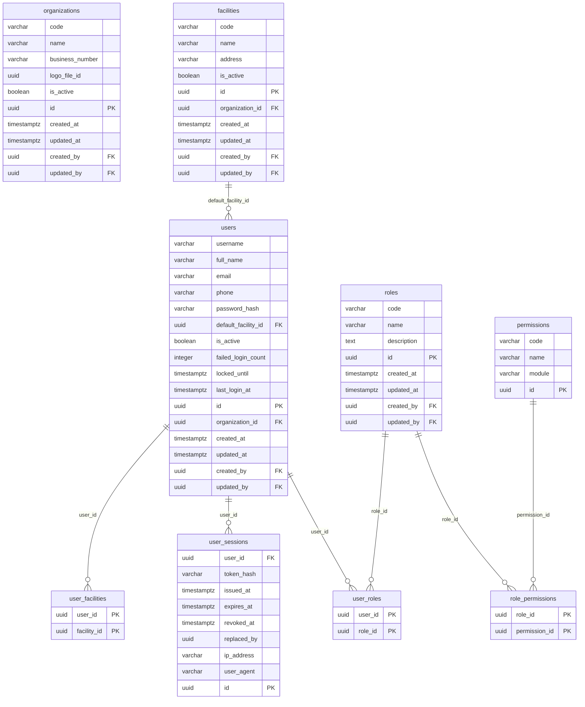
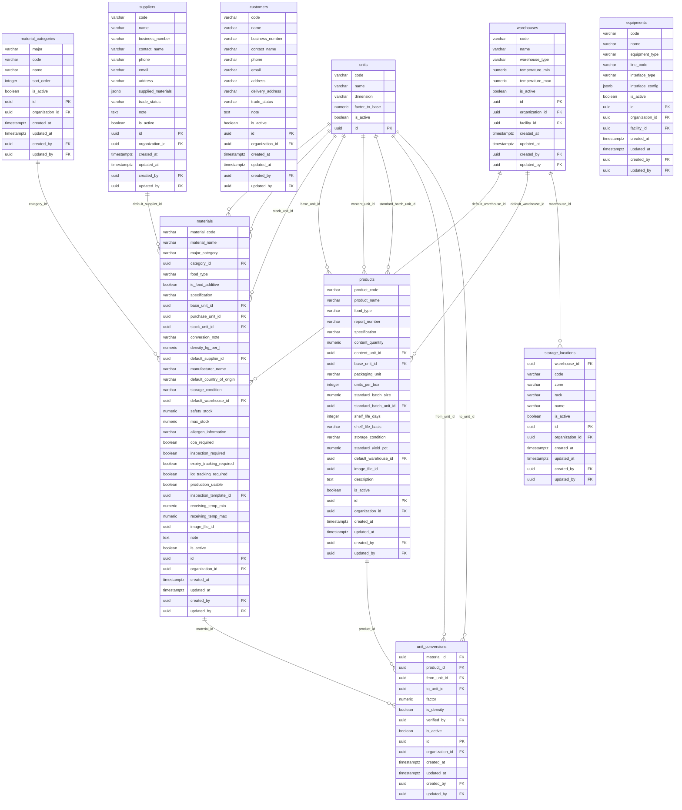
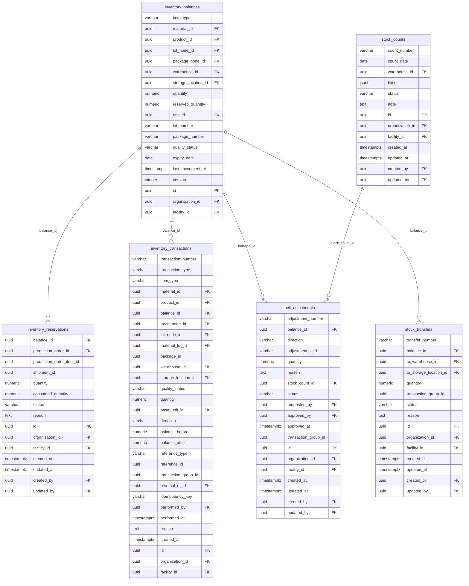
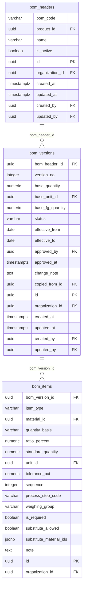
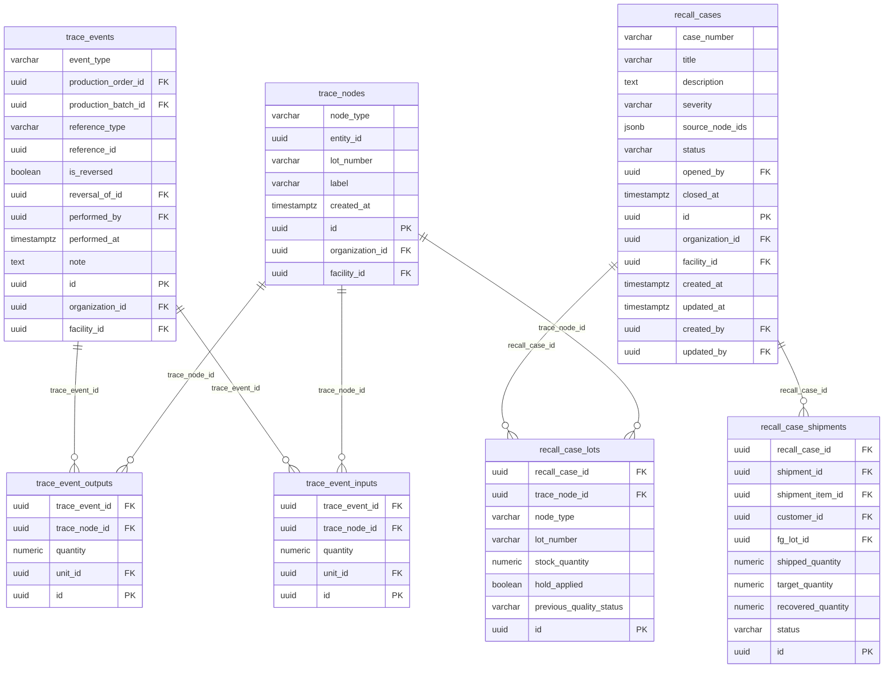
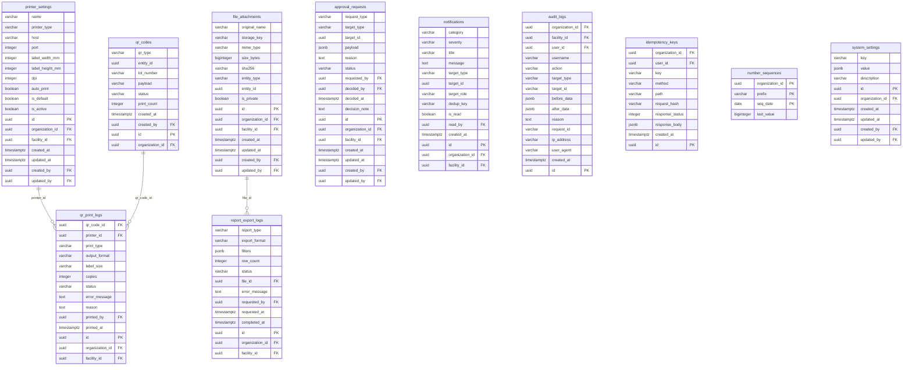
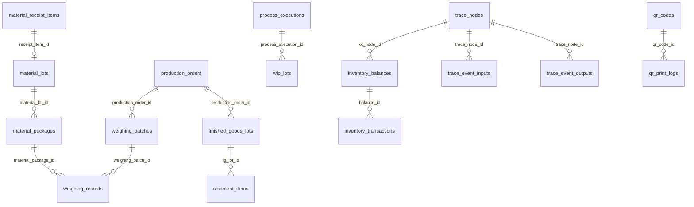

# 데이터베이스 ERD

> 이 문서는 `infrastructure/scripts/gen_erd.py` 가 SQLAlchemy 모델(`backend/app/models`)에서 자동 생성한다. 모델 변경 후 재생성할 것.

## 공통 규칙

- PK: UUID (`gen_random_uuid()`/uuid4). 조직 데이터는 `organization_id`, 공장 데이터는 `facility_id` 보유.
- 감사 컬럼: `created_at/created_by/updated_at/updated_by`. 수량 `NUMERIC(20,6)`, 시각 `TIMESTAMPTZ`(UTC 저장, Asia/Seoul 표시), 제조/기한 `DATE`.
- 거래 테이블은 물리 삭제 금지(DB 트리거), 마스터는 `is_active` 비활성화.
- 불변 테이블(UPDATE/DELETE 트리거 차단): inventory_transactions, audit_logs, trace_events, trace_event_inputs, trace_event_outputs, qr_print_logs.
- 음수 재고 금지: `inventory_balances.quantity >= 0`, `reserved_quantity <= quantity`, `inventory_transactions.balance_after >= 0` CHECK.
- 유일성: 조직별 품목코드/LOT/포장번호/거래번호, `(qr_type, entity_id)`, `(organization_id, idempotency_key)`, 재고 키 `(lot_node_id, package_node_id, warehouse_id, storage_location_id) NULLS NOT DISTINCT`.
- 공통 FK(`organization_id`, `facility_id`, `created_by`, `updated_by`)는 다이어그램 가독성을 위해 관계선을 생략한다.

총 테이블 수: **78**

## 조직/권한

## 기준정보

## 입고/OCR/품질

```mermaid
erDiagram
  material_receipts {
    varchar receipt_number
    timestamptz received_at
    uuid supplier_id FK
    varchar purchase_order_number
    varchar receipt_document_number
    varchar coa_number
    uuid received_by FK
    uuid inspected_by FK
    varchar inspection_result
    uuid approved_by FK
    timestamptz approved_at
    uuid posted_by FK
    timestamptz posted_at
    varchar status
    text status_reason
    text note
    integer version
    uuid id PK
    uuid organization_id FK
    uuid facility_id FK
    timestamptz created_at
    timestamptz updated_at
    uuid created_by FK
    uuid updated_by FK
  }
  material_receipt_items {
    uuid receipt_id FK
    integer line_no
    uuid material_id FK
    varchar supplier_lot_number
    varchar manufacturer_name
    numeric quantity
    uuid unit_id FK
    integer package_count
    numeric package_quantity
    numeric package_weight
    varchar country_of_origin
    date manufactured_date
    date expiry_date
    varchar expiry_type
    varchar storage_condition
    uuid warehouse_id FK
    uuid storage_location_id FK
    numeric unit_price
    numeric amount
    uuid material_lot_id FK
    uuid ocr_job_id FK
    text note
    uuid id PK
    uuid organization_id FK
    timestamptz created_at
    timestamptz updated_at
    uuid created_by FK
    uuid updated_by FK
  }
  material_lots {
    uuid material_id FK
    uuid receipt_item_id FK
    varchar lot_number
    varchar supplier_lot_number
    uuid supplier_id FK
    varchar manufacturer_name
    varchar country_of_origin
    date received_date
    date manufactured_date
    date expiry_date
    varchar expiry_type
    numeric original_quantity
    uuid base_unit_id FK
    varchar quality_status
    varchar status
    uuid qr_code_id FK
    uuid trace_node_id FK
    uuid id PK
    uuid organization_id FK
    uuid facility_id FK
    timestamptz created_at
    timestamptz updated_at
    uuid created_by FK
    uuid updated_by FK
  }
  material_packages {
    uuid material_lot_id FK
    varchar package_number
    integer sequence_no
    numeric original_quantity
    uuid base_unit_id FK
    varchar package_status
    uuid qr_code_id FK
    uuid trace_node_id FK
    uuid id PK
    uuid organization_id FK
    timestamptz created_at
    timestamptz updated_at
    uuid created_by FK
    uuid updated_by FK
  }
  receipt_documents {
    varchar document_type
    varchar document_number
    date issued_date
    uuid file_id FK
    varchar file_hash
    uuid is_duplicate_of FK
    jsonb coa_test_results
    text note
    uuid id PK
    uuid organization_id FK
    uuid facility_id FK
    timestamptz created_at
    timestamptz updated_at
    uuid created_by FK
    uuid updated_by FK
  }
  document_links {
    uuid document_id FK
    varchar entity_type
    uuid entity_id
    uuid id PK
    uuid organization_id FK
    timestamptz created_at
    timestamptz updated_at
    uuid created_by FK
    uuid updated_by FK
  }
  ocr_jobs {
    uuid document_id FK
    uuid receipt_id FK
    varchar provider
    varchar document_type
    varchar status
    integer attempts
    text raw_text
    jsonb structured_result
    numeric overall_confidence
    boolean review_required
    text error_message
    timestamptz started_at
    timestamptz completed_at
    uuid confirmed_by FK
    timestamptz confirmed_at
    uuid id PK
    uuid organization_id FK
    uuid facility_id FK
    timestamptz created_at
    timestamptz updated_at
    uuid created_by FK
    uuid updated_by FK
  }
  ocr_extracted_fields {
    uuid ocr_job_id FK
    integer item_index
    varchar field_name
    text raw_value
    text normalized_value
    numeric confidence
    boolean is_missing
    boolean needs_review
    text corrected_value
    uuid corrected_by FK
    uuid matched_entity_id
    uuid id PK
    uuid organization_id FK
  }
  inspection_templates {
    varchar code
    varchar name
    varchar target_type
    boolean is_active
    uuid id PK
    uuid organization_id FK
    timestamptz created_at
    timestamptz updated_at
    uuid created_by FK
    uuid updated_by FK
  }
  inspection_template_items {
    uuid template_id FK
    varchar item_code
    varchar item_name
    varchar value_type
    numeric min_value
    numeric max_value
    varchar criteria
    boolean is_required
    integer sort_order
    uuid id PK
  }
  quality_inspections {
    varchar inspection_number
    varchar target_type
    uuid target_id
    uuid template_id FK
    varchar source
    varchar overall_result
    text nonconformance_reason
    varchar disposition
    uuid inspected_by FK
    timestamptz inspected_at
    uuid approved_by FK
    timestamptz approved_at
    jsonb photo_file_ids
    text note
    uuid id PK
    uuid organization_id FK
    uuid facility_id FK
    timestamptz created_at
    timestamptz updated_at
    uuid created_by FK
    uuid updated_by FK
  }
  quality_inspection_results {
    uuid inspection_id FK
    varchar item_code
    varchar item_name
    varchar result
    numeric measured_value
    varchar text_value
    varchar standard
    boolean out_of_range
    text note
    uuid id PK
  }
  inspection_templates ||--o{ inspection_template_items : "template_id"
  inspection_templates ||--o{ quality_inspections : "template_id"
  material_lots ||--o{ material_packages : "material_lot_id"
  material_lots ||--o{ material_receipt_items : "material_lot_id"
  material_receipt_items ||--o{ material_lots : "receipt_item_id"
  material_receipts ||--o{ material_receipt_items : "receipt_id"
  material_receipts ||--o{ ocr_jobs : "receipt_id"
  ocr_jobs ||--o{ material_receipt_items : "ocr_job_id"
  ocr_jobs ||--o{ ocr_extracted_fields : "ocr_job_id"
  quality_inspections ||--o{ quality_inspection_results : "inspection_id"
  receipt_documents ||--o{ document_links : "document_id"
  receipt_documents ||--o{ ocr_jobs : "document_id"
```

## 재고

## BOM

## 생산/MES

```mermaid
erDiagram
  production_orders {
    varchar order_number
    date production_date
    uuid product_id FK
    uuid bom_version_id FK
    jsonb bom_snapshot
    uuid routing_version_id FK
    jsonb routing_snapshot
    numeric planned_quantity
    uuid planned_unit_id FK
    numeric target_fg_quantity
    integer batch_count
    numeric batch_size
    varchar line_code
    varchar work_center
    uuid assignee_id FK
    timestamptz scheduled_start
    timestamptz scheduled_end
    timestamptz actual_start
    timestamptz actual_end
    varchar status
    varchar status_before_hold
    uuid approved_by FK
    timestamptz approved_at
    uuid closed_by FK
    timestamptz closed_at
    jsonb mass_balance
    text note
    uuid qr_code_id FK
    uuid id PK
    uuid organization_id FK
    uuid facility_id FK
    timestamptz created_at
    timestamptz updated_at
    uuid created_by FK
    uuid updated_by FK
  }
  production_order_items {
    uuid production_order_id FK
    uuid bom_item_id FK
    varchar item_type
    uuid material_id FK
    varchar quantity_basis
    numeric ratio_percent
    numeric required_quantity
    numeric per_batch_quantity
    uuid unit_id FK
    numeric tolerance_pct
    integer sequence
    varchar weighing_group
    varchar process_step_code
    boolean substitute_allowed
    jsonb substitute_material_ids
    numeric issued_quantity
    uuid id PK
    uuid organization_id FK
  }
  production_batches {
    uuid production_order_id FK
    varchar batch_number
    integer batch_no
    numeric planned_quantity
    varchar status
    timestamptz started_at
    timestamptz completed_at
    uuid id PK
    uuid organization_id FK
    uuid facility_id FK
    timestamptz created_at
    timestamptz updated_at
    uuid created_by FK
    uuid updated_by FK
  }
  production_routings {
    varchar routing_code
    uuid product_id FK
    varchar name
    boolean is_active
    uuid id PK
    uuid organization_id FK
    timestamptz created_at
    timestamptz updated_at
    uuid created_by FK
    uuid updated_by FK
  }
  routing_versions {
    uuid routing_id FK
    integer version_no
    varchar status
    uuid approved_by FK
    timestamptz approved_at
    uuid id PK
    uuid organization_id FK
    timestamptz created_at
    timestamptz updated_at
    uuid created_by FK
    uuid updated_by FK
  }
  routing_steps {
    uuid routing_version_id FK
    uuid process_definition_id FK
    integer sequence
    varchar step_name
    boolean is_required
    uuid equipment_id FK
    jsonb parameter_specs
    varchar output_type
    uuid id PK
    uuid organization_id FK
  }
  process_definitions {
    varchar code
    varchar name
    varchar process_type
    integer default_sequence
    varchar work_center
    uuid equipment_id FK
    numeric standard_minutes
    numeric standard_temperature
    numeric standard_pressure
    numeric standard_speed
    jsonb parameter_specs
    text inspection_criteria
    jsonb required_records
    boolean approval_required
    boolean qr_required
    boolean is_ccp
    varchar output_type
    boolean is_active
    uuid id PK
    uuid organization_id FK
    timestamptz created_at
    timestamptz updated_at
    uuid created_by FK
    uuid updated_by FK
  }
  weighing_batches {
    varchar lot_number
    uuid production_order_id FK
    uuid production_batch_id FK
    uuid product_id FK
    uuid bom_version_id FK
    varchar weighing_group
    uuid parent_id FK
    numeric total_quantity
    uuid unit_id FK
    uuid completed_by FK
    timestamptz completed_at
    uuid warehouse_id FK
    uuid storage_location_id FK
    timestamptz usable_until
    varchar quality_status
    varchar status
    varchar next_process_code
    uuid qr_code_id FK
    uuid trace_node_id FK
    uuid id PK
    uuid organization_id FK
    uuid facility_id FK
    timestamptz created_at
    timestamptz updated_at
    uuid created_by FK
    uuid updated_by FK
  }
  weighing_records {
    uuid weighing_batch_id FK
    uuid production_order_id FK
    uuid production_batch_id FK
    uuid production_order_item_id FK
    uuid material_id FK
    uuid material_lot_id FK
    uuid material_package_id FK
    boolean is_substitute
    numeric target_quantity
    numeric actual_quantity
    uuid unit_id FK
    numeric tolerance_min
    numeric tolerance_max
    numeric gross_weight
    numeric tare_weight
    boolean is_stable
    uuid scale_equipment_id FK
    varchar input_method
    uuid inventory_transaction_id FK
    uuid weighed_by FK
    timestamptz weighed_at
    varchar approval_status
    uuid approved_by FK
    varchar status
    uuid reversed_by FK
    timestamptz reversed_at
    text reversal_reason
    uuid id PK
    uuid organization_id FK
    uuid facility_id FK
    timestamptz created_at
    timestamptz updated_at
    uuid created_by FK
    uuid updated_by FK
  }
  wip_lots {
    varchar lot_number
    uuid production_order_id FK
    uuid production_batch_id FK
    uuid product_id FK
    uuid process_execution_id FK
    integer routing_step_sequence
    numeric quantity
    uuid unit_id FK
    varchar quality_status
    varchar status
    uuid qr_code_id FK
    uuid trace_node_id FK
    uuid id PK
    uuid organization_id FK
    uuid facility_id FK
    timestamptz created_at
    timestamptz updated_at
    uuid created_by FK
    uuid updated_by FK
  }
  process_executions {
    varchar execution_number
    uuid production_order_id FK
    uuid production_batch_id FK
    uuid routing_step_id FK
    integer routing_step_sequence
    uuid process_definition_id FK
    uuid equipment_id FK
    boolean is_rework
    uuid merge_approved_by FK
    timestamptz started_at
    timestamptz paused_at
    numeric paused_minutes
    timestamptz completed_at
    numeric total_input_quantity
    numeric good_output_quantity
    numeric defective_quantity
    numeric waste_quantity
    numeric process_loss_quantity
    numeric moisture_change_quantity
    uuid unit_id FK
    numeric process_yield
    varchar quality_status
    varchar inspection_result
    uuid operated_by FK
    uuid approved_by FK
    timestamptz approved_at
    varchar status
    text note
    text reason
    jsonb photo_file_ids
    uuid id PK
    uuid organization_id FK
    uuid facility_id FK
    timestamptz created_at
    timestamptz updated_at
    uuid created_by FK
    uuid updated_by FK
  }
  process_inputs {
    uuid process_execution_id FK
    varchar input_type
    uuid trace_node_id FK
    varchar lot_number
    uuid production_batch_id FK
    numeric quantity
    uuid unit_id FK
    uuid inventory_transaction_id FK
    uuid input_by FK
    timestamptz input_at
    uuid id PK
    uuid organization_id FK
  }
  process_outputs {
    uuid process_execution_id FK
    varchar output_type
    uuid trace_node_id FK
    varchar lot_number
    numeric quantity
    uuid unit_id FK
    uuid inventory_transaction_id FK
    uuid id PK
    uuid organization_id FK
  }
  process_parameter_records {
    uuid process_execution_id FK
    varchar parameter_code
    varchar parameter_name
    numeric value_numeric
    varchar value_text
    varchar unit
    numeric min_value
    numeric max_value
    boolean out_of_range
    varchar source
    boolean is_ccp
    uuid recorded_by FK
    timestamptz recorded_at
    uuid id PK
    uuid organization_id FK
  }
  packaging_consumptions {
    uuid process_execution_id FK
    uuid production_order_id FK
    uuid material_id FK
    uuid material_lot_id FK
    uuid material_package_id FK
    numeric issued_quantity
    numeric used_quantity
    numeric defective_quantity
    numeric waste_quantity
    numeric returned_quantity
    uuid unit_id FK
    uuid fg_lot_id FK
    uuid inventory_transaction_id FK
    uuid consumed_by FK
    timestamptz consumed_at
    uuid id PK
    uuid organization_id FK
    uuid facility_id FK
  }
  process_definitions ||--o{ process_executions : "process_definition_id"
  process_definitions ||--o{ routing_steps : "process_definition_id"
  process_executions ||--o{ packaging_consumptions : "process_execution_id"
  process_executions ||--o{ process_inputs : "process_execution_id"
  process_executions ||--o{ process_outputs : "process_execution_id"
  process_executions ||--o{ process_parameter_records : "process_execution_id"
  process_executions ||--o{ wip_lots : "process_execution_id"
  production_batches ||--o{ process_executions : "production_batch_id"
  production_batches ||--o{ process_inputs : "production_batch_id"
  production_batches ||--o{ weighing_batches : "production_batch_id"
  production_batches ||--o{ weighing_records : "production_batch_id"
  production_batches ||--o{ wip_lots : "production_batch_id"
  production_order_items ||--o{ weighing_records : "production_order_item_id"
  production_orders ||--o{ packaging_consumptions : "production_order_id"
  production_orders ||--o{ process_executions : "production_order_id"
  production_orders ||--o{ production_batches : "production_order_id"
  production_orders ||--o{ production_order_items : "production_order_id"
  production_orders ||--o{ weighing_batches : "production_order_id"
  production_orders ||--o{ weighing_records : "production_order_id"
  production_orders ||--o{ wip_lots : "production_order_id"
  production_routings ||--o{ routing_versions : "routing_id"
  routing_steps ||--o{ process_executions : "routing_step_id"
  routing_versions ||--o{ production_orders : "routing_version_id"
  routing_versions ||--o{ routing_steps : "routing_version_id"
  weighing_batches ||--o{ weighing_records : "weighing_batch_id"
```

## 완제품/출고

```mermaid
erDiagram
  finished_goods_lots {
    varchar lot_number
    uuid product_id FK
    uuid production_order_id FK
    uuid production_batch_id FK
    uuid process_execution_id FK
    date manufactured_date
    timestamptz production_started_at
    timestamptz production_ended_at
    date expiry_date
    date expiry_basis_date
    numeric content_quantity
    uuid content_unit_id FK
    numeric planned_quantity
    numeric total_produced_quantity
    numeric good_quantity
    numeric defective_quantity
    numeric waste_quantity
    numeric total_input_quantity
    numeric net_weight
    numeric loss_quantity
    uuid base_unit_id FK
    numeric production_yield
    varchar quality_status
    uuid released_by FK
    timestamptz released_at
    uuid responsible_id FK
    uuid warehouse_id FK
    varchar status
    uuid qr_code_id FK
    uuid trace_node_id FK
    uuid id PK
    uuid organization_id FK
    uuid facility_id FK
    timestamptz created_at
    timestamptz updated_at
    uuid created_by FK
    uuid updated_by FK
  }
  finished_goods_packages {
    uuid fg_lot_id FK
    uuid parent_package_id FK
    varchar package_level
    varchar package_number
    numeric quantity
    varchar status
    uuid qr_code_id FK
    uuid trace_node_id FK
    uuid id PK
    uuid organization_id FK
    timestamptz created_at
    timestamptz updated_at
    uuid created_by FK
    uuid updated_by FK
  }
  shipment_headers {
    varchar shipment_number
    date shipment_date
    uuid customer_id FK
    varchar delivery_address
    jsonb delivery_info
    uuid handler_id FK
    uuid approved_by FK
    timestamptz confirmed_at
    varchar status
    uuid transaction_group_id
    uuid trace_node_id FK
    text note
    uuid id PK
    uuid organization_id FK
    uuid facility_id FK
    timestamptz created_at
    timestamptz updated_at
    uuid created_by FK
    uuid updated_by FK
  }
  shipment_items {
    uuid shipment_id FK
    integer line_no
    uuid product_id FK
    uuid fg_lot_id FK
    uuid fg_package_id FK
    uuid warehouse_id FK
    numeric quantity
    uuid unit_id FK
    numeric returned_quantity
    uuid inventory_transaction_id FK
    uuid id PK
    uuid organization_id FK
  }
  shipment_returns {
    varchar return_number
    uuid shipment_id FK
    uuid shipment_item_id FK
    uuid fg_lot_id FK
    numeric quantity
    text reason
    uuid quarantine_warehouse_id FK
    varchar status
    uuid decided_by FK
    timestamptz decided_at
    uuid id PK
    uuid organization_id FK
    uuid facility_id FK
    timestamptz created_at
    timestamptz updated_at
    uuid created_by FK
    uuid updated_by FK
  }
  finished_goods_lots ||--o{ finished_goods_packages : "fg_lot_id"
  finished_goods_lots ||--o{ shipment_items : "fg_lot_id"
  finished_goods_lots ||--o{ shipment_returns : "fg_lot_id"
  finished_goods_packages ||--o{ shipment_items : "fg_package_id"
  shipment_headers ||--o{ shipment_items : "shipment_id"
  shipment_headers ||--o{ shipment_returns : "shipment_id"
  shipment_items ||--o{ shipment_returns : "shipment_item_id"
```

## 추적/회수

## 공통

## 영역 간 핵심 관계

